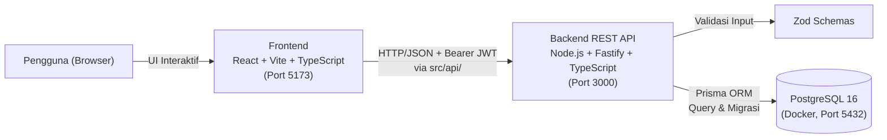
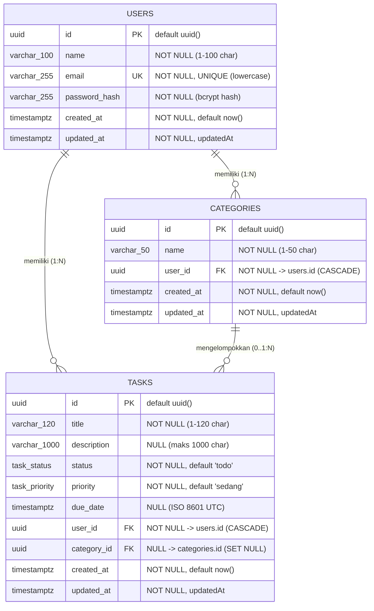

# ARCHITECTURE.md — Catatan & To-do dengan Login (Proyek #1)

Versi: 1.0 · Disusun oleh: Arsitek Sistem · Acuan: `docs/PRD.md`, `AGENTS.md`
Kontrak API terkait: `docs/openapi.yaml`

---

## 1. Gambaran Sistem

Aplikasi dibangun dengan arsitektur tiga lapis (*three-tier*) sederhana: **Frontend (SPA React)** berkomunikasi dengan **Backend (REST API Fastify)** melalui HTTP/JSON, dan Backend menyimpan data ke **PostgreSQL** melalui **Prisma ORM**.



### Alur Satu Request Utama (Contoh: Membuat Tugas)
1. Pengguna mengisi form tugas di React lalu klik **Simpan**.
2. `frontend/src/api/tasks.ts` mengirim `POST /api/tasks` beserta header `Authorization: Bearer <token>`.
3. Middleware autentikasi Fastify (`plugins/auth.ts`) memverifikasi JWT dan menempelkan `request.user = { userId, email }`.
4. Route handler (`routes/tasks.ts`) memvalidasi body memakai Zod (`schemas/task.schema.ts`). Jika gagal → `400 VALIDATION_ERROR`.
5. Service (`services/task.service.ts`) memeriksa kepemilikan `categoryId` (jika dikirim) lalu menyimpan baris baru ke tabel `tasks` via Prisma.
6. Response `201 Created` berisi objek tugas (termasuk ringkasan kategori) dikembalikan ke Frontend dan ditampilkan di daftar.

---

## 2. Desain Database (ERD)

Database menggunakan **PostgreSQL** dengan **Prisma ORM**.
Konvensi penamaan:
- **Database (PostgreSQL):** `snake_case` (tabel jamak: `users`, `categories`, `tasks`).
- **Kode Prisma & JSON API:** `camelCase` (dipetakan memakai `@map` dan `@@map`).
- **Primary Key:** `UUID` (`uuid()`) untuk menghindari enumerasi ID berurutan.



### Enum PostgreSQL
- `task_status`: `'todo' | 'doing' | 'done'` (bawaan: `'todo'`)
- `task_priority`: `'rendah' | 'sedang' | 'tinggi'` (bawaan: `'sedang'`)

### Constraint Unik, Foreign Key, dan Indeks Penting
| Tabel | Constraint / Indeks | Kolom | Aturan & Tujuan |
|---|---|---|---|
| `users` | `UNIQUE` | `email` | Email unik global; dinormalisasi lowercase + trim sebelum simpan/cari. |
| `categories` | `FOREIGN KEY` | `user_id → users(id)` | `ON DELETE CASCADE` (jika akun dihapus, kategorinya ikut terhapus). |
| `categories` | `UNIQUE` | `(user_id, name)` | Nama kategori unik per pengguna. Service juga melakukan cek case-insensitive agar `"Kuliah"` dan `"kuliah"` tidak duplikat. |
| `categories` | `INDEX` | `(user_id)` | Mempercepat daftar kategori milik pengguna. |
| `tasks` | `FOREIGN KEY` | `user_id → users(id)` | `ON DELETE CASCADE`. |
| `tasks` | `FOREIGN KEY` | `category_id → categories(id)` | **`ON DELETE SET NULL`** — menghapus kategori **tidak** menghapus tugas (US-10). |
| `tasks` | `INDEX` | `(user_id, created_at DESC)` | Mempercepat daftar tugas urut terbaru + pagination (US-6). |
| `tasks` | `INDEX` | `(user_id, status, priority)` | Mempercepat filter berdasarkan status dan prioritas (US-9). |
| `tasks` | `INDEX` | `(category_id)` | Mempercepat filter kategori dan operasi `ON DELETE SET NULL`. |

### Pencegahan Masalah N+1
Saat mengambil daftar tugas (`GET /api/tasks`), backend **wajib** menyertakan relasi kategori dalam satu operasi query Prisma (`include: { category: { select: { id: true, name: true } } }`) dan saat mengambil daftar kategori (`GET /api/categories`) menggunakan `_count: { select: { tasks: true } }`. Tidak boleh ada query database di dalam loop per baris.

---

## 3. Struktur Folder

Struktur dibuat ringkas dan selaras dengan pedoman tim (`backend.md` dan `frontend.md`).

```text
catatan-todo-login-for-learn-v1/
├── docker-compose.yml            # Layanan PostgreSQL lokal (dan opsional adminer)
├── STATUS.md                     # Papan status proyek
├── README.md                     # Panduan menjalankan proyek (Fase 7)
├── docs/
│   ├── PRD.md
│   ├── ARCHITECTURE.md           # Dokumen ini
│   ├── openapi.yaml              # Kontrak API (sumber kebenaran)
│   └── QA_REPORT.md              # Hasil audit QA (Fase 5)
├── backend/
│   ├── .env.example
│   ├── package.json
│   ├── tsconfig.json             # strict: true
│   ├── prisma/
│   │   ├── schema.prisma         # Definisi model sesuai ERD
│   │   ├── migrations/           # Migrasi SQL Prisma
│   │   └── seed.ts               # Data contoh (1 user demo, kategori, tugas)
│   ├── src/
│   │   ├── server.ts             # Entry point (listen port dari env)
│   │   ├── app.ts                # Factory Fastify (memudahkan tes integrasi)
│   │   ├── lib/
│   │   │   ├── env.ts            # Validasi env dengan Zod
│   │   │   ├── prisma.ts         # Singleton PrismaClient
│   │   │   ├── password.ts       # Hash & verify bcryptjs
│   │   │   └── errors.ts         # Kelas AppError & kode error standar
│   │   ├── plugins/
│   │   │   ├── auth.ts           # Plugin @fastify/jwt + decorator authenticate
│   │   │   ├── cors.ts           # Plugin @fastify/cors dari env CORS_ORIGIN
│   │   │   └── errorHandler.ts   # Centralized error handler seragam
│   │   ├── schemas/
│   │   │   ├── auth.schema.ts    # Skema Zod register & login
│   │   │   ├── task.schema.ts    # Skema Zod CRUD + query filter/pagination
│   │   │   └── category.schema.ts# Skema Zod CRUD kategori
│   │   ├── services/
│   │   │   ├── auth.service.ts
│   │   │   ├── task.service.ts
│   │   │   └── category.service.ts
│   │   └── routes/
│   │       ├── health.ts         # GET /health
│   │       ├── auth.ts           # /api/auth/*
│   │       ├── tasks.ts          # /api/tasks/*
│   │       └── categories.ts     # /api/categories/*
│   └── tests/
│       ├── health.test.ts
│       ├── auth.test.ts
│       ├── tasks.test.ts
│       └── categories.test.ts
└── frontend/
    ├── .env.example              # VITE_API_BASE_URL, VITE_USE_MOCK
    ├── package.json
    ├── tsconfig.json             # strict: true
    ├── vite.config.ts
    ├── src/
    │   ├── main.tsx
    │   ├── App.tsx               # Routing & proteksi halaman (AuthGuard)
    │   ├── types/
    │   │   └── api.ts            # Tipe TypeScript sesuai openapi.yaml
    │   ├── api/
    │   │   ├── client.ts         # Wrapper fetch + injeksi Bearer token + tangani 401
    │   │   ├── auth.ts           # Fungsi endpoint auth
    │   │   ├── tasks.ts          # Fungsi endpoint tasks
    │   │   ├── categories.ts     # Fungsi endpoint categories
    │   │   └── mock/             # Data & handler mock (dipakai di Fase 3)
    │   ├── hooks/
    │   │   ├── useAuth.tsx       # Context/hook sesi login & logout
    │   │   ├── useTasks.ts       # State daftar tugas, filter, pagination
    │   │   └── useCategories.ts  # State kategori
    │   ├── components/
    │   │   ├── Layout.tsx        # Header, navigasi, tombol logout
    │   │   ├── TaskForm.tsx      # Form buat/edit tugas
    │   │   ├── TaskList.tsx      # Daftar tugas + pagination + 3 state (loading/error/kosong)
    │   │   ├── TaskFilters.tsx   # Pencarian judul + filter status, prioritas, kategori
    │   │   ├── CategoryManager.tsx # Kelola kategori (buat, ubah, hapus)
    │   │   └── ConfirmDialog.tsx # Konfirmasi hapus (US-8 & US-10)
    │   └── pages/
    │       ├── LoginPage.tsx
    │       ├── RegisterPage.tsx
    │       └── DashboardPage.tsx # Halaman utama tugas + kategori
    └── tests/
        ├── LoginPage.test.tsx
        ├── TaskList.test.tsx
        └── e2e/                  # Tes Playwright alur utama
```

---

## 4. Keputusan Teknis (ADR Singkat)

Bagian ini menjawab seluruh keputusan arsitektur inti serta **4 pertanyaan terbuka pada PRD bagian 14**.

### ADR-01: Autentikasi, Masa Berlaku Token, dan Refresh Token *(PRD §14 #1)*
- **Keputusan:** Menggunakan **JWT Access Token** (`HS256` via `@fastify/jwt`) tanpa refresh token pada v1. Masa berlaku bawaan **1 jam** (`JWT_EXPIRES_IN=1h`, dapat diubah lewat `.env` untuk latihan sesi kedaluwarsa). Password di-hash menggunakan `bcryptjs` (cost factor 10). Endpoint `POST /api/auth/logout` disediakan untuk kerapian kontrak; pada v1, logout membersihkan token di sisi klien.
- **Alasan:** Alur stateless JWT paling sederhana untuk dipahami secara menyeluruh pada proyek fondasi. Masa berlaku 1 jam cukup nyaman untuk penggunaan normal sekaligus membatasi risiko jika token bocor, dan mudah diuji untuk US-4 (redirect ke login saat sesi kedaluwarsa). `bcryptjs` murni JavaScript sehingga bebas kendala kompilasi native di Windows maupun Docker Linux.
- **Alternatif yang ditolak:**
  - *Refresh token + rotasi di database:* menambah tabel baru dan alur silent refresh yang terlalu kompleks untuk v1.
  - *Server-side session dengan Redis:* menambah komponen infrastruktur di luar stack tetap.

### ADR-02: Penyimpanan Token di Frontend *(PRD §14 #2)*
- **Keputusan:** Menyimpan JWT access token di **`localStorage`** (key: `todo_access_token`) dan mengirimkannya melalui header `Authorization: Bearer <token>` di `frontend/src/api/client.ts`.
- **Alasan:** Transparan untuk dipelajari (token mudah dilihat di DevTools dan tab Network), sesi bertahan saat browser di-refresh (tidak seperti penyimpanan memori tanpa refresh token), dan tidak memerlukan mekanisme anti-CSRF tambahan.
- **Konsekuensi keamanan & mitigasi:** `localStorage` dapat dibaca oleh JavaScript jika aplikasi terkena celah XSS (*Cross-Site Scripting*). Mitigasi wajib: dilarang memakai `dangerouslySetInnerHTML`, semua teks dirender lewat escaping bawaan React, token berumur pendek (1 jam), dan CORS dibatasi ke origin frontend saja.
- **Alternatif yang ditolak:**
  - *Memori (React state saja):* sesi langsung hilang setiap kali halaman di-refresh, buruk untuk UX tanpa refresh token.
  - *Cookie `httpOnly` + `SameSite`:* lebih aman terhadap XSS untuk produksi, tetapi memerlukan konfigurasi CORS credentials dan perlindungan CSRF yang menambah kompleksitas tahap fondasi.

### ADR-03: Kode Status Saat Mengakses Data Milik Pengguna Lain *(PRD §14 #3)*
- **Keputusan:** Mengembalikan **`403 Forbidden`** (`code: "FORBIDDEN"`) jika resource (tugas atau kategori) **ada di database** tetapi `userId`-nya milik pengguna lain, dan mengembalikan **`404 Not Found`** (`code: "NOT_FOUND"`) jika ID tidak ditemukan sama sekali.
- **Alasan:** Selaras langsung dengan tujuan belajar di PRD §2 (*membedakan 400, 401, 403, 404, 500*) dan skenario Bug Lab di PRD §12 (*mengakses tugas pengguna lain → 403*). Karena ID memakai UUID v4 acak, risiko *ID enumeration* sangat rendah.
- **Alternatif yang ditolak:**
  - *Mengembalikan `404 Not Found` untuk data milik orang lain:* lebih ketat terhadap *existence disclosure* pada sistem berisiko tinggi, tetapi menghilangkan pembedaan semantik 403 vs 404 yang dibutuhkan di proyek belajar ini.

### ADR-04: Strategi Penghapusan Data — Hard Delete vs Soft Delete *(PRD §14 #4)*
- **Keputusan:** Menggunakan **Hard Delete** (penghapusan permanen dari tabel PostgreSQL) untuk tugas maupun kategori, dilengkapi dialog konfirmasi di Frontend sebelum mengirim `DELETE`.
- **Alasan:** PRD tidak meminta fitur "Tempat Sampah / Restore" ataupun audit log. Hard delete menjaga semua query tetap sederhana (tanpa filter `deleted_at IS NULL` di mana-mana) dan mencegah bentrok constraint `UNIQUE (user_id, name)` saat pengguna menghapus kategori lalu membuat kategori baru dengan nama yang sama.
- **Alternatif yang ditolak:**
  - *Soft delete (`deleted_at`):* menambah kompleksitas query, indeks unik parsial, dan tidak memberi nilai tambah tanpa fitur pemulihan.

### ADR-05: Pola Validasi Input
- **Keputusan:** Semua input eksternal (`body`, `params`, `querystring`) divalidasi di Backend dengan **Zod** sebelum menyentuh lapisan service/database. Validasi ringan juga dipasang di form Frontend untuk umpan balik cepat, tetapi Backend tetap menjadi penjaga utama (*source of truth*).
- **Alasan:** Menjamin keamanan dan integritas data, langsung menghasilkan tipe TypeScript yang ketat (`strict`), dan memenuhi aturan `AGENTS.md`.
- **Alternatif yang ditolak:** Validasi manual dengan `if/else` di setiap route (rawan tidak konsisten); hanya validasi di frontend (mudah dilewati lewat curl/Postman).

### ADR-06: Strategi Penanganan Error Seragam
- **Keputusan:** Semua error diproses oleh satu plugin `errorHandler.ts` di Fastify dan dikembalikan dalam format tunggal:
  ```json
  {
    "error": {
      "code": "VALIDATION_ERROR",
      "message": "Judul tugas wajib diisi (1-120 karakter)."
    }
  }
  ```
  Pemetaan kode standar:
  - `400 VALIDATION_ERROR`: payload, query, atau format UUID tidak valid.
  - `401 INVALID_CREDENTIALS`: email atau password salah saat login (pesan generik, tidak membocorkan mana yang salah).
  - `401 UNAUTHORIZED`: token hilang, tidak valid, atau kedaluwarsa.
  - `403 FORBIDDEN`: mencoba mengakses/mengubah data milik pengguna lain.
  - `404 NOT_FOUND`: resource tidak ditemukan.
  - `409 CONFLICT`: email sudah terdaftar atau nama kategori duplikat untuk pengguna yang sama.
  - `500 INTERNAL_SERVER_ERROR`: error tak terduga (detail dicatat di log server, klien hanya menerima pesan umum Bahasa Indonesia).
- **Alasan:** Memenuhi standar `AGENTS.md`, memudahkan Frontend menangani error secara konsisten (termasuk auto-redirect ke `/login` saat `401 UNAUTHORIZED` untuk US-4).
- **Alternatif yang ditolak:** Merakit response error secara manual di tiap route handler.

---

## 5. Pemetaan User Story ke Endpoint

| User Story | Endpoint Terkait |
|---|---|
| US-1 (Register) | `POST /api/auth/register` |
| US-2 (Login) | `POST /api/auth/login`, `GET /api/auth/me` |
| US-3 (Logout) | `POST /api/auth/logout` |
| US-4 (Sesi kedaluwarsa) | `GET /api/auth/me` + respons `401 UNAUTHORIZED` di semua endpoint terproteksi |
| US-5 (Buat tugas) | `POST /api/tasks` |
| US-6 (Daftar tugas + pagination) | `GET /api/tasks`, `GET /api/tasks/{id}` |
| US-7 (Ubah isi & status tugas) | `PATCH /api/tasks/{id}` |
| US-8 (Hapus tugas) | `DELETE /api/tasks/{id}` |
| US-9 (Cari & filter tugas) | `GET /api/tasks?q=&status=&priority=&categoryId=&page=&limit=` |
| US-10 (CRUD kategori) | `GET /api/categories`, `POST /api/categories`, `PATCH /api/categories/{id}`, `DELETE /api/categories/{id}` |
| US-11 (Kelompokkan tugas ke kategori) | `POST /api/tasks`, `PATCH /api/tasks/{id}`, `GET /api/tasks` |
| Infrastruktur | `GET /health` |

---

## 6. Risiko dan Hal yang Sengaja Ditunda

### Risiko Teknis & Mitigasi
| Risiko | Dampak | Mitigasi |
|---|---|---|
| Token dicuri lewat XSS karena disimpan di `localStorage` | Pembajakan sesi hingga 1 jam | Larang `dangerouslySetInnerHTML`, sanitasi bawaan React, token berumur pendek, CORS ketat. |
| Token masih aktif di server setelah logout (stateless JWT) | Jika token disalin sebelum logout, tetap berlaku sampai kedaluwarsa | Masa berlaku token dibatasi 1 jam; token blacklist/revocation dicatat untuk v2. |
| Query N+1 pada daftar tugas + kategori | Penurunan performa saat data tumbuh | Wajib pakai Prisma `include` pada `GET /api/tasks` dan `_count` pada `GET /api/categories`, diverifikasi saat QA. |
| Duplikasi kategori beda huruf besar/kecil (`"Kuliah"` vs `"kuliah"`) | Pengguna bingung punya dua kategori mirip | Service melakukan cek case-insensitive sebelum insert/update selain constraint unik di DB. |

### Hal yang Sengaja Ditunda (Masuk Daftar v2)
- Migrasi penyimpanan token ke cookie `httpOnly` + proteksi CSRF + refresh token rotation.
- Revokasi token di sisi server (*token denylist*) saat logout.
- Rate limiting khusus endpoint `/api/auth/login` dan `/api/auth/register` (dapat ditambah lewat `@fastify/rate-limit` nanti).
- Fitur di luar lingkup PRD: reset password, verifikasi email, OAuth, kolaborasi/berbagi tugas, subtugas, lampiran, notifikasi, mode gelap, peran admin.
